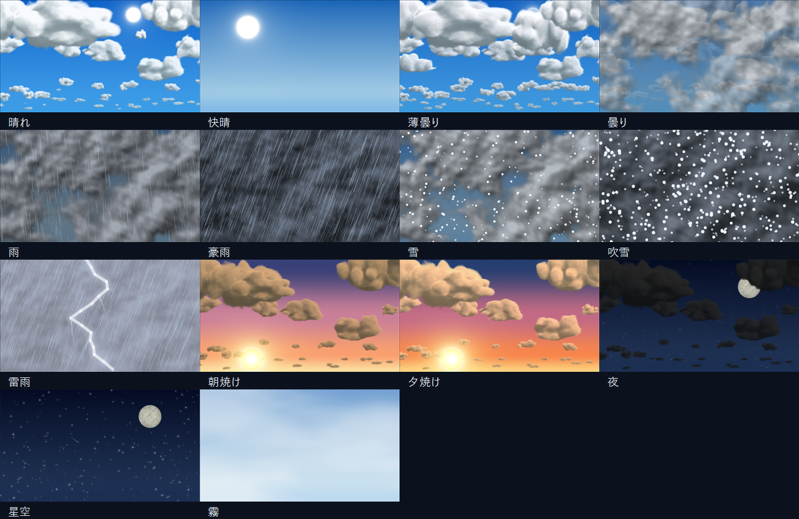

# SYNC_WeatherFX（天気演出）

AviUtl2用の統合型天気演出プラグインです。グループ名は `SYNC`、本体は `SYNC_WeatherFX.auf2` の1つです。Delphi 37.0 / Win64、AviUtl2 v2.1.16以降を対象とします。

## 統合天気（既定）

追加直後は、時刻11.0・曇り具合35の「晴れ」を表示します。濃い青空に、白い積雲を近景から遠景まで配置します。太陽は上寄りに、白い発光中心と周辺光で描きます（初期X=160、Y=-200、直径64）。画像素材は不要です。1つのプラグインで空・雲・太陽・月・虹・雨・雪などを組み合わせられます。

風速10・風向0度（右向き）が初期設定です。時間経過に合わせて雲が流れ、画面外から異なる形の新しい雲が入ってきます。雲ごとに輪郭や高さを生成するため、少数の同じ形を並べて繰り返す表示を避けています。


[雲の動き（12秒のGIF）](Sample/cloud_flow.gif)。GIFは確認用に色数を削減しています。



1. フィルターオブジェクトとして「SYNC → 天気演出」を単体配置するか、画像・動画へ「天気演出」を追加します。単体配置は水面演出（AquaFX）と同じ方式です。
2. 最上部の「天気プリセット」を選択し、**「設定を反映」**を押します。
3. 各グループを開き、必要な項目を調整します。

天気プリセットは「晴れ」「快晴」「薄曇り」「曇り」「雨」「豪雨」「雪」「吹雪」「雷雨」「朝焼け」「夕焼け」「夜」「星空」「霧」の14種類です。選択しただけでは現在値と描画は変わりません。反映後は保存された各パラメーターだけを使い、再適用するまで編集値を上書きしません。シードは反映時にも維持します。

## 折りたたみグループ

通常は「基本設定」だけを開き、他のグループは折りたたんでいます。

| グループ | 調整内容 |
| --- | --- |
| 基本設定 | 時刻、曇り具合、空を描画 |
| 雨・雪 | 雨量、雪量、雨粒サイズ、雪片サイズ、落下速度 |
| 風 | 風速、風向、風表現の強さ |
| 太陽 | X/Y、サイズ、透明度 |
| 月 | X/Y、サイズ、透明度、満ち欠け、欠ける方向 |
| 虹 | X/Y、円弧半径、円弧角度、帯幅、透明度、二重虹 |
| その他の天候 | 雷・雷線の太さ・全面発光、霧、オーロラ、陽炎、蜃気楼、星・星サイズ、流れ星・頻度、日差し、月明かり、シード |
| 個別演出（従来） | 従来の44スタイルと共通調整項目 |

時刻は0.00～240.00で、24時間周期です。12は昼、18は夕方、24は翌日の0時、36は翌日の昼に相当します。中間点で時刻を変えると、空と雲の色が連続的に変化します。太陽と月は時刻で自動移動しません。

曇り具合・雨量・雪量は独立しています。曇り具合100でも雨量0なら雨は降りません。雨と雪は同時に使えます。風速は雲・雨・雪・霧に影響し、風表現0では流線を描きません。風向は0度が右、90度が下です。落下速度は100を基準とする倍率（%）です。

太陽・月・虹の座標は画面中心を原点とするピクセル座標で、正のXは右、正のYは下です。太陽・月のサイズは直径、虹のサイズは半径です。各透明度は0で表示、100で非表示となります。その他の現象は0で無効、100で最大です。月の満ち欠けは100で満月、50で半月、0で新月です。

虹は透明度0で色をはっきり表示でき、透明度を上げると薄い表示になります。虹を雨量・時刻で強制的に切り替えません。二重虹の外側は色順を反転し、薄く描きます。

入力画像へ天候だけを重ねたい場合は「空を描画」をオフにします。陽炎・蜃気楼は処理中の画像に簡易的な屈折を加えます。他のレイヤーの画像を直接取得する処理は行いません。画像・動画へ追加した場合は、そのオブジェクトの標準描画で全体の位置・拡大率・透明度を調整できます。単体のフィルターオブジェクトでは太陽・月・虹の専用項目で位置などを調整します。

## 天候ごとの調整

薄曇りは曇り具合55で白い雲を増やし、曇りは68で青みを残した明るい曇天にしています。雲量の変化では小さな雲が育つようにし、大きな雲全体を薄く透かす表示を避けます。雪プリセットの雪片サイズは10、吹雪は14です。

夜プリセットの曇り具合は30です。朝焼けは6時、夕焼けは18時を初期時刻とし、画面の最下端を地平線・水平線として青紫→赤→オレンジ→黄色のグラデーションを描きます。6時・18時付近で滑らかに強まり、太陽の周囲と雲にも暖色を加えます。太陽Yスライダーの上限値ではなく、描画画像の下端が基準です。

太陽を水平線へ近づけると、現在の太陽X/Yを中心に周囲の空と雲が白黄から橙色へ強く明るくなり、背景色と光が滑らかに溶け合います。太陽を高く上げるとこの光は弱まり、太陽透明度100では消えます。

朝夕の「設定を反映」では、現在のシーン解像度に合わせて太陽を下端近くへ配置します。適用後は通常の太陽X/Yとして自由に編集でき、時刻を変えても太陽の位置を自動移動させません。解像度を変更した場合は再反映またはX/Yで調整できます。

雷雨は太い雷線と全面発光を組み合わせます。「雷線の太さ」はピクセル単位で、0にすると線を描かなくなります。「雷の全面発光」は0～100で調整します。雷を80、線の太さを0、全面発光を75などにすると、画面全体が光るパターンになります。全面発光0では雷線だけになります。

星空は星サイズ4、流れ星75、流れ星頻度12回/分が初期設定です。「流れ星」は表示の強さ、「流れ星頻度（回/分）」は0～120で発生頻度を調整します。頻度0で停止します。発生時刻と軌道はランダムに変わりますが、同じ時刻・シードでは同じ結果を再現します。

霧は昼の空へ白いもやを重ねるプリセットです。画像・動画へ白い霧だけを重ねたいときは「空を描画」をオフにします。

## 従来の個別演出

「描画方式」を「個別演出」にすると、従来の44スタイルを使えます。「個別演出（従来）」の「スタイル」を選び、「設定」を押す方法でも切り替わります。統合型へ戻すときは「描画方式」を切り替えるか、天気プリセットの「設定を反映」を押してください。

| 系統 | スタイル |
| --- | --- |
| 太陽 | 真昼の太陽、朝日、夕日 |
| 日差し | 通常の日差し、強い日差し、光芒、薄明光線、木漏れ日 |
| 月 | 満月、半月、三日月、細い三日月 |
| 月明かり | 弱い月明かり、通常の月明かり、強い月明かり、霧越しの月明かり |
| 空 | 青空、朝焼け、夕焼け、薄暮、夜空 |
| 星 | 星空、きらめく星空、明るい星空、流れ星 |
| 雲 | 白い雲、黒い雲、薄雲、うろこ雲、積乱雲、雨雲 |
| 雨 | 小雨、通常の雨、大雨、豪雨 |
| 雪 | 小雪、通常の雪、大雪、吹雪 |
| 虹 | 通常の虹、半円の虹、浅い虹、二重虹、薄い虹 |

旧版の項目名と選択値は維持しています。ただし、旧版で保存した個別演出には「描画方式」の保存値がないため、更新後は「個別演出」に切り替えて従来の保存値を使用してください。天気プリセットの反映は、個別演出の調整値を変更しません。

## 開発・検査

`SYNC_WeatherFX.dproj`を開きます。ビルド手順は [note.md](note.md)、仕様は [docs/SPECIFICATION.md](docs/SPECIFICATION.md)、実装の判断と範囲は [docs/IMPLEMENTATION.md](docs/IMPLEMENTATION.md) にあります。出力先は `C:\ProgramData\aviutl2\Plugin\SYNC_WeatherFX\` です。

最新のビルド・検査記録は `Win64/LatestVerification`、画像の参照SHA-256は `Tests/Baselines/render_images.json` に保存しています。古いWin64内の試作画像・バックアップ・ビルドキャッシュは整理済みです。検査画像とEXEは下記のスクリプトで再生成できます。

```powershell
.\Tests\run_tests.ps1
.\Tests\run_tests.ps1 -Benchmark
.\Tests\run_tests.ps1 -Profile
.\Tests\run_tests.ps1 -DefaultPreview
.\Tests\run_tests.ps1 -CloudFlowPreview -ImageDirectory .\Win64\CloudFlow\Frames
.\Tests\make_cloud_animation.ps1
.\Tests\make_preview.ps1 -WeatherPresets
```

検査EXEは本番AUF2を読み込み、晴れの初期値、14プリセット、グループ、時刻周期、曇りと降水の独立性、風、天体配置、虹の透明度、屈折、逆シーク、雪・星のサイズ、雷の太さと全面発光、流れ星の頻度、白い霧の合成、従来44スタイルを検査します。`-Profile`は空・太陽・雲・雨・雪・霧・星を分けて1080pで計測し、画像出力先へ`profile1080.csv`を保存します。CPU計測はホストなしの参考値で、AviUtl2の実際の再生FPSではありません。

実機での表示・操作、複数レイヤーでの負荷と見た目の採否は未確認です。SDKの標準グループと一括設定を使用しており、専用GUIは設けていません。太陽・月は全円を基準に描き、太陽の地平線クリッピングは後段のAviUtl2フィルターに任せます。

`setup`は前回の指定どおり、SYNC_AquaFX用の名前と内容をそのまま保持しています。WeatherFXの配布処理としては未整備です。

本体はGPL-3.0-only、SDK由来の定義はMITライセンスです。[LICENSE](LICENSE) と [THIRD_PARTY_NOTICES.md](THIRD_PARTY_NOTICES.md) を同梱しています。
